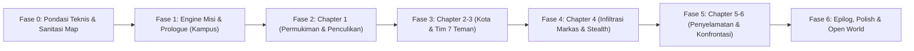

# Development Roadmap — BATAS KAWASAN
## Peta Jalan Pengembangan Game Bertahap (Iterative Milestone Plan)

Dokumen ini memetakan seluruh tahapan pengembangan game **Batas Kawasan** secara berurutan dan terukur. Sesuai prinsip pengembangan profesional: **"Jangan membangun seluruh fitur sekaligus, bangun per modul secara bertahap dan utamakan performa."**

---

## Ringkasan Fase Pengembangan

---

## Rincian Milestone & Tahapan Kerja

### FASE 0: Pondasi Teknis & Penataan Repositori (Groundwork)
> **Fokus Utama:** Membersihkan ketidakteraturan hasil syncback, menata repositori Git, dan menyiapkan arsitektur kode Luau yang modular.

- [x] **Task 0.1 — Ekstraksi Script dari Binary `.rbxm`:**
  - Mengekstrak `DialogueSystem` dan `MissionHUD` dari `StarterCharacterScripts.rbxm` ke dalam file teks `.client.luau` murni di `src/StarterPlayer/StarterCharacterScripts/`.
  - Memastikan seluruh kode klien terbaca di Git diff dan dapat diedit langsung via VS Code.
- [x] **Task 0.2 — Sanitasi Spawn & Folder Kosong Workspace:**
  - Menetapkan `MainSpawn` di Kampus ($-350, 0.5, 285$) sebagai spawn point resmi primer.
  - Menangani objek `SpawnLocation` duplikat di root Workspace dan folder kosong `SpawnPoint/` serta `Environment/`.
- [x] **Task 0.3 — Arsitektur Modul Bersama (Shared Core Modules):**
  - Membuat folder `src/ReplicatedStorage/Shared/` di Rojo project.
  - Membangun modul utilitas:
    - `QuestDefinitions.luau`: Tabel konfigurasi statis 18 misi.
    - `NetworkUtil.luau`: Pembungkus RemoteEvent yang aman dan ber-rate-limit.
    - `DialogueData.luau`: Database dialog terstruktur.

**Kriteria Selesai (DoD):**
- [x] `rojo build` berjalan sukses tanpa peringatan.
- [x] Semua script adalah file teks `.luau`.
- [x] Pemain spawn secara konsisten di area kampus.

---

### FASE 1: Core Quest Engine & Prologue Kampus (Misi 1–2)
> **Fokus Utama:** Membangun *state machine* quest yang andal di server dan mengimplementasikan alur Prologue di area kampus.

- [x] **Task 1.1 — Server Quest Manager (`QuestService`):**
  - Sistem pencatatan status misi per pemain (`NotStarted` $\rightarrow$ `InProgress` $\rightarrow$ `Completed`).
  - Pemancar update status misi ke client via RemoteEvent `MissionUpdate`.
- [x] **Task 1.2 — Peningkatan Client HUD & Dialogue Manager:**
  - Menghubungkan GUI `MissionHUD` dan `BatasKawasanDialogue` dengan data dari `QuestService`.
  - Dukungan interaksi multi-perangkat (PC, Mobile, Gamepad).
- [x] **Task 1.3 — Misi 1 (*A Normal Day*):**
  - Pemain memulai hari di kampus, menerima petunjuk awal dari NPC `Mahasiswa_Kampus`.
  - Mengenal tata ruang kampus (lapangan, kantin, area parkir).
- [x] **Task 1.4 — Misi 2 (*Meet the Crew*):**
  - Berkeliling kampus menemui teman-teman mahasiswa.
  - Perkenalan awal karakter MC 2 (interaksi singkat yang memperlihatkan kontras kepribadian).

**Kriteria Selesai (DoD):**
- [x] Pemain dapat menyelesaikan Misi 1 dan 2 dari awal hingga akhir tanpa *bug*.
- [x] Data progres tersinkronisasi mulus di mode multiplayer.

---

### FASE 2: Chapter 1 — Permukiman Warga & Penculikan Adik (Misi 3–4)
> **Fokus Utama:** Mengaktifkan kawasan permukiman warga, ancaman penagih utang, dan peristiwa penculikan adik perempuan MC 1.

- [x] **Task 2.1 — Interaksi Kawasan Permukiman:**
  - Menyiapkan NPC warga, NPC `Pemilik_Warung`, dan area pos ronda.
- [x] **Task 2.2 — Misi 3 (*Family Pressure*):**
  - MC 1 pulang ke rumahnya di permukiman, menemukan surat/ancaman utang ayahnya.
  - Teror verbal dari penagih utang di depan rumah warga.
- [x] **Task 2.3 — Misi 4 (*Kidnapped!*):**
  - Kelompok penagih menculik adik perempuan MC 1.
  - MC 1 memeriksa jejak, bertanya kepada Pemilik Warung, dan mendapati petunjuk mobil mencurigakan mengarah ke kawasan industri timur.

**Kriteria Selesai (DoD):**
- [x] Cutscene/dialog penculikan adik MC 1 berjalan dramatis.
- [x] Motivasi MC 1 terkunci kuat untuk melangkah ke babak investigasi.

---

### FASE 3: Chapter 2 & 3 — Pusat Kota & Pembentukan Tim (Misi 5–9)
> **Fokus Utama:** Eksplorasi kawasan pusat kota, konvergensi cerita MC 1 dan MC 2, serta perpecahan persahabatan 12 teman.

- [x] **Task 3.1 — Misi 5 & 6 (*The Missing Brother* & *Hidden Connection*):**
  - MC 2 menyelidiki jejak kakaknya yang hilang di pusat kota (ruko, minimarket, bengkel).
  - MC 1 dan MC 2 bertemu; menyadari benang merah bahwa pihak penagih utang dan penculik kakak MC 2 adalah sindikat yang sama: **BLACK SERPENT**.
- [x] **Task 3.2 — Misi 7 & 8 (*Divided Friends* & *Seven Stand Together*):**
  - Pertemuan 12 teman di kampus: 5 orang menolak karena takut bahaya, 7 orang bersedia membantu.
  - Pengalokasian peran 7 teman (Strategist, Technician, Scout, Driver, Fighter, Negotiator, Supporter).
- [x] **Task 3.3 — Misi 9 (*First Investigation*):**
  - Investigasi terpadu pertama mencari titik lemah pengamanan markas.

**Kriteria Selesai (DoD):**
- [x] Dinamika pertemanan tersampaikan dengan bobot emosional yang baik.
- [x] Tim inti penyelamat terbentuk secara resmi.

---

### FASE 4: Chapter 4 — Infiltrasi Markas & Mekanik Stealth (Misi 10–11)
> **Fokus Utama:** Mengimplementasikan mekanik stealth, kerucut pandang CCTV, dan kepanikan penyusupan tunggal MC 1.

- [ ] **Task 4.1 — Stealth Detection Engine:**
  - Pemrograman kerucut pandang (*Cone of Vision*) pada kamera CCTV dan menara pengintai di markas.
  - Meteran kecurigaan (*Detection Meter*) dan sistem alarm markas.
- [ ] **Task 4.2 — Misi 10 (*Into the Serpent*):**
  - MC 1 menyusup sendirian di malam hari demi mencari adiknya.
  - Menemukan lokasi adik disekap di ruang interogasi basement, serta menemukan berkas penahanan kakak MC 2.
- [ ] **Task 4.3 — Misi 11 (*CCTV Alert*):**
  - Alarm berbunyi saat MC 1 terdeteksi kamera.
  - Misi pelarian cepat melintasi perimeter luar markas menuju jalan raya.

**Kriteria Selesai (DoD):**
- Mekanik stealth responsif dan adil bagi pemain.
- Sesi pelarian memberikan ketegangan gameplay yang tinggi.

---

### FASE 5: Chapter 5 & 6 — Operasi Penyelamatan Sandera & Klimaks (Misi 12–17)
> **Fokus Utama:** Misi penyelamatan sandera ganda (Adik MC 1 & Kakak MC 2), aksi kooperatif, dan pertarungan final melawan Pemimpin BLACK SERPENT.

- [ ] **Task 5.1 — Misi 12 & 13 (*The Rescue Plan* & *Infiltration*):**
  - Rencana terpadu bersama tim 7 teman.
  - Pembobolan gerbang dan pemadaman sebagian sistem CCTV oleh Technician.
- [ ] **Task 5.2 — Misi 14 & 15 (*Free the Captives* & *Escape Together*):**
  - Pembebasan adik MC 1 dari ruang interogasi basement.
  - Pembebasan kakak MC 2 dari ruang kontrol gudang.
  - Pengawalan kedua sandera menuju titik evakuasi di tengah serbuan penjaga.
- [ ] **Task 5.3 — Misi 16 & 17 (*The Final Boundary* & *The Sacrifice*):**
  - Konfrontasi langsung melawan Pemimpin BLACK SERPENT.
  - Adegan sinematik dramatis: Kakak MC 2 menahan tembakan demi melindungi adiknya (keduanya dipastikan selamat).
  - Kekalahan pimpinan organisasi kriminal.

**Kriteria Selesai (DoD):**
- Misi penyelamatan kedua sandera sukses diselesaikan secara tim.
- Momen emosional pengorbanan kakak MC 2 tersampaikan dengan kuat tanpa melanggar aturan cerita.

---

### FASE 6: Epilog, Open World Post-Game & Polish (Misi 18+)
> **Fokus Utama:** Penutupan cerita utama, pembukaan fitur open-world bebas, dan optimasi performa menyeluruh.

- [ ] **Task 6.1 — Misi 18 (*Back to Campus*):**
  - Pemain kembali ke suasana kampus yang damai.
  - Momen perpisahan/refleksi dengan teman-teman dan keluarga yang telah selamat.
  - Petunjuk misteri saudara perempuan MC 2 yang belum terpecahkan (pengantar sekuel).
- [ ] **Task 6.2 — Pembukaan Fitur Open World Bebas:**
  - Side quest warga di permukiman dan toko kota.
  - Aktivitas kampus bebas dan mini-games.
- [ ] **Task 6.3 — Polish, Audio & Optimasi:**
  - Integrasi ambient sound khas Indonesia (suara jangkrik malam hari, hiruk pikuk kota, adzan/suasana warung jika relevan).
  - Optimasi *part instancing* pada 182 marka jalan.
  - Uji stabilitas frame rate 60 FPS pada perangkat mobile.

---

## Aturan Transisi Antar Fase

1. **Gatekeeping:** Tidak boleh memulai Fase berikutnya sebelum seluruh kriteria *Definition of Done (DoD)* pada fase aktif terpenuhi dan diuji.
2. **Review & Backup:** Setiap pergantian fase besar wajib dilakukan peninjauan status repositori Git dan validasi build Rojo.
